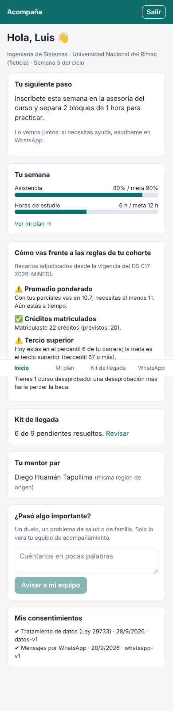
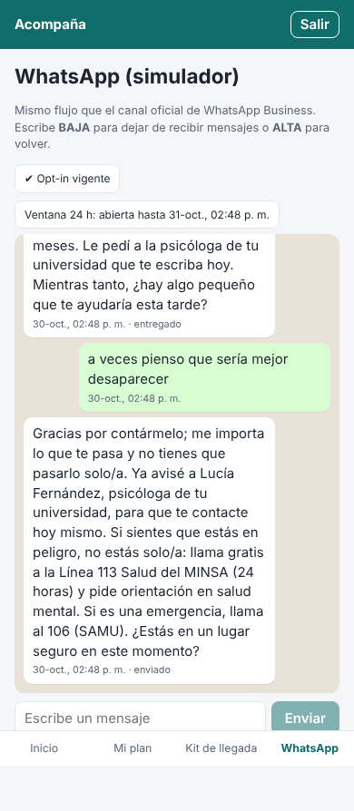
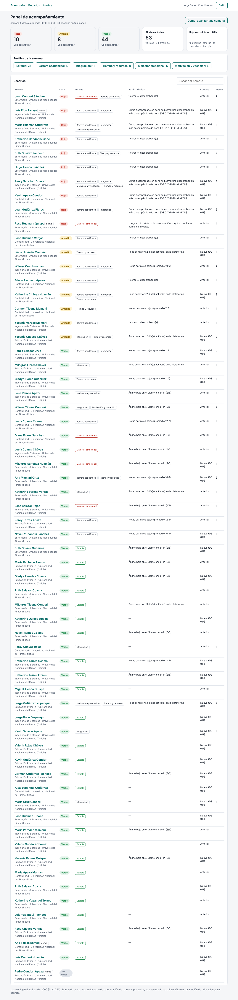
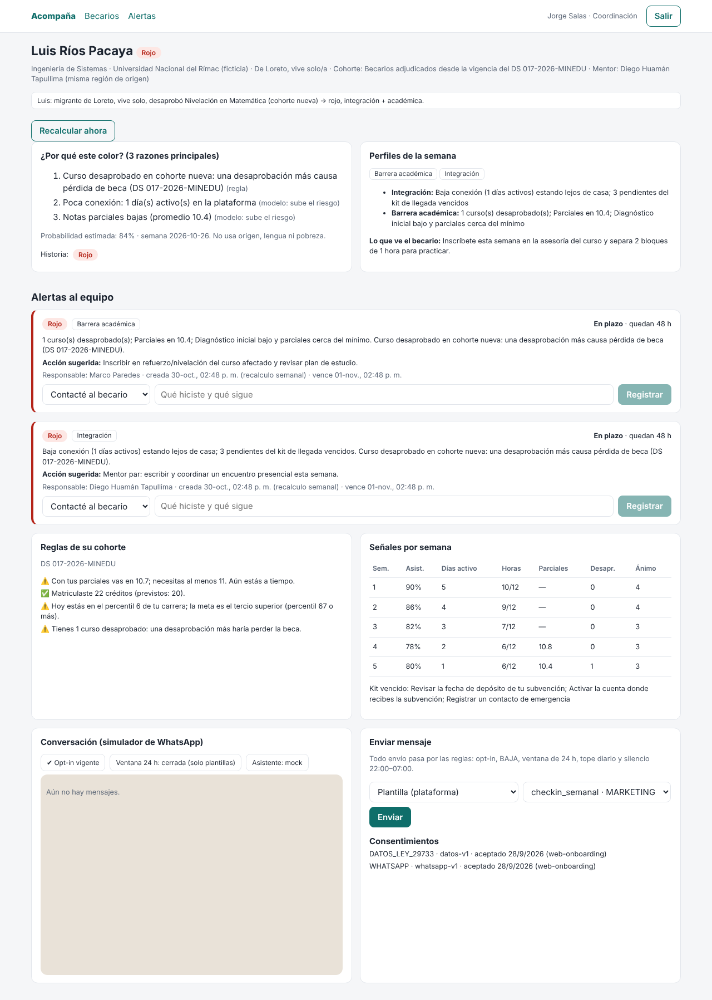
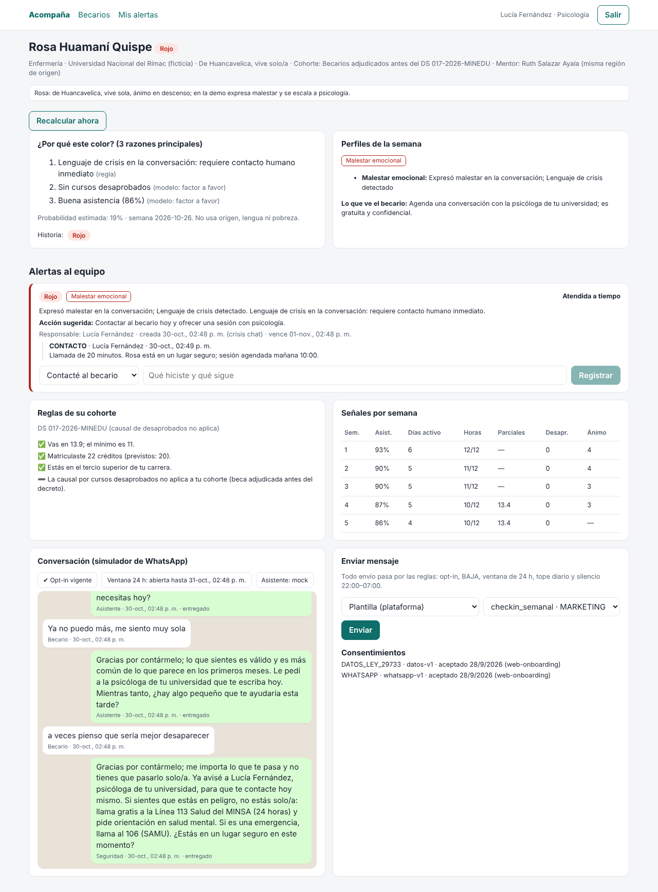
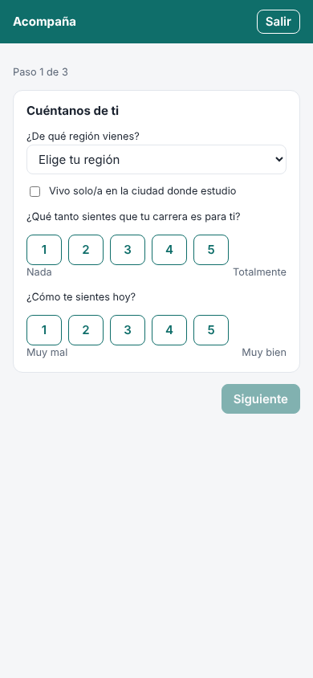

# Acompaña — prevención del abandono en becarios Beca 18 / Pronabec

MVP de hackathon. Detecta a tiempo las presiones académicas, emocionales, vocacionales y económicas de los becarios en su **primer ciclo**
y convierte cada señal en **alerta → perfil → acción humana → seguimiento**.

> **Solo datos sintéticos.** Universidades, personas y teléfonos son ficticios. No hay datos personales reales en el repositorio.

## 1. Correr la demo (un solo comando)

Requisitos: Docker con Docker Compose. Puertos libres: 3000, 4000 y 5432.

```bash
cd acompana
docker compose up --build
```

La primera vez construye las imágenes, aplica las migraciones y siembra 204 becarios. Luego abre:

- Web: http://localhost:3000
- API: http://localhost:4000/health

Para reiniciar la demo desde cero: `docker compose down -v && docker compose up`.

### Sin Docker (desarrollo)

Requisitos: Node 22 y PostgreSQL 16 con una base `acompana` (usuario/clave `acompana`).

```bash
cd acompana
cp .env.example .env
npm install
npm run db:migrate      # aplica migraciones
npm run db:seed         # siembra datos sintéticos (borra y recrea)
npm run dev:api         # http://localhost:4000
npm run dev:worker      # cola, reintentos, recordatorios, check-ins
npm run dev:web         # http://localhost:3000
```

### Usar Claude de verdad (opcional)

Por defecto el asistente usa `MockProvider` (determinista, sin clave) para que la demo no dependa de la red. Para Claude:

| Opción | Variables |
|---|---|
| API de Anthropic | `LLM_PROVIDER=anthropic`, `ANTHROPIC_API_KEY=...` (modelo por defecto `claude-opus-5-5`, configurable con `LLM_MODEL`) |
| Amazon Bedrock | `LLM_PROVIDER=bedrock`, `AWS_REGION=...` y credenciales AWS (modelo `anthropic.claude-opus-5-5`, configurable con `BEDROCK_MODEL`) |

Con la API de Anthropic se activa el *fallback* del lado del servidor ante una negativa por categoría de seguridad; si el modelo declina,
el asistente responde con un mensaje seguro dentro de su alcance. La detección de crisis corre **antes** del modelo en todos los casos.

## 2. Guion de la demo (≈7 minutos)

Entra en http://localhost:3000 y elige el usuario en cada paso. Para la vista de becario, usa el navegador en modo móvil o una ventana angosta.

| # | Quién | Qué hacer | Qué se ve |
|---|---|---|---|
| 1 | **Ana Torres** (becaria) | Abre *Inicio* | Verde. Cumple todas las reglas de su cohorte. No tiene alertas. |
| 2 | **Luis Ríos** (becario) | Abre *Inicio* y *Mi plan* | Siguiente paso concreto (sin regaños). "Tienes 1 curso desaprobado: una desaprobación más haría perder la beca" (cohorte DS 017). Refuerzo marcado en su plan. |
| 3 | **Luis** | En *WhatsApp* escribe: `¿qué clases tengo mañana?`, luego `no cumplí mis horas de estudio`, luego `cuándo depositan la subvención` y `¿quién ganó el partido de fútbol?` | El asistente usa sus datos (horario, metas, FAQ), propone un paso pequeño, y redirige el tema ajeno. |
| 4 | **Jorge Salas** (coordinador) | Abre el panel → clic en **Rojo** → *Luis Ríos Pacaya* | Rojo con 3 razones (regla DS 017 + baja conexión + parciales bajos). Perfiles **Integración + Barrera académica**. Dos alertas rojas con responsable (tutor y mentor) y reloj de 48 h. |
| 5 | **Marco Paredes** (tutor) | *Mis alertas* → registra "Contacté al becario…" en la de Luis | La alerta pasa a "Atendida a tiempo" y cuenta para el cumplimiento de 48 h. |
| 6 | **Jorge Salas** | En la ficha de **Rosa Huamaní** → *Enviar mensaje* → plantilla `checkin_semanal` → Enviar. Envía otra plantilla | La primera sale (plantilla, porque la ventana de 24 h está cerrada). La segunda queda **diferida por tope diario**. |
| 7 | **Rosa Huamaní** (becaria) | En *WhatsApp* responde `2`, luego `Ya no puedo más, me siento muy sola`, luego `a veces pienso que sería mejor desaparecer` | El check-in registra el ánimo. El malestar recibe una respuesta empática y deriva a psicología. Ante lenguaje de crisis **el asistente no improvisa**: avisa a la psicóloga y muestra la línea de ayuda configurable. |
| 8 | **Lucía Fernández** (psicóloga) | *Mis alertas* → alerta roja de Rosa (origen: *crisis chat*) → registra el contacto | Alerta roja de Malestar emocional creada en el momento, vence en 48 h; queda "Atendida a tiempo". En la ficha se ve toda la conversación y las decisiones de política. |
| 9 | **Rosa** | Escribe `BAJA` | Confirmación única. Cualquier envío posterior (prueba desde el panel) queda **bloqueado: BAJA solicitada**. `ALTA` la reactiva con un nuevo consentimiento. |
| 10 | **Jorge Salas** | Panel → **Demo: avanzar una semana** | Se generan las señales de la semana siguiente y se recalcula todo. Lo atendido mejora (Rosa baja a verde y su alerta sigue en seguimiento); lo no atendido aparece **vencido** y baja el % de cumplimiento de 48 h. |
| 11 | **Pedro Condori** (becario nuevo) | Entra | Onboarding del día cero: región, si vive solo, encaje con la carrera, ánimo, diagnóstico corto de matemática y lectura, y consentimientos (datos — Ley 29733 — y WhatsApp) guardados con fecha, versión y texto exacto. |

Otros usuarios: **Carmen Rojas (Pronabec)** ve las 3 universidades; **Diego Huamán (mentor)** solo ve a los becarios que tiene asignados y no ve el detalle emocional.

## 3. Arquitectura

```
Becario (web móvil / simulador WhatsApp)          Equipo (panel coordinador / tutor / mentor)
                │                                               │
                └──────────────► apps/web (Next.js) ◄───────────┘
                                       │ JWT con rol
                                       ▼
                        apps/api (Fastify) ── control de acceso por rol
                                       │
              packages/db/services: recálculo · alertas · conversación · envío
                 │                 │                   │
     packages/domain (puro)   packages/llm        packages/messaging
     reglas, semáforo,        LLMProvider:        MessagingChannel:
     perfiles, alertas,       Anthropic/Bedrock/  Simulator (demo),
     policyGate, crisis       Mock                Meta/AWS (Etapa 2)
                                       │
                         PostgreSQL (Prisma) ◄── apps/worker (pg-boss: entregas,
                                                 reintentos, recordatorios, check-ins,
                                                 recálculo semanal)
```

```
acompana/
  apps/api        Fastify: auth demo por rol, /scholar, /chat, /panel
  apps/worker     pg-boss: deliver-message, class-reminders, weekly-checkin, weekly-recalc
  apps/web        Next.js: /becario/* (móvil) y /panel/*
  packages/domain Lógica pura con pruebas (sin I/O)
  packages/db     Prisma (schema, migraciones), servicios de aplicación y seed sintético
  packages/llm    LLMProvider + prompt del asistente + herramientas
  packages/messaging  MessagingChannel, SimulatorChannel, catálogo de plantillas
  infra/          AWS CDK (opcional)
```

Desvío respecto al plan aprobado: los servicios de aplicación viven en `packages/db/src/services` (los usan la API, el worker y el seed,
y así se evita una dependencia circular entre paquetes).

## 4. Reglas de negocio (dónde están)

| Regla | Dónde | Configurable en |
|---|---|---|
| Promedio aprobatorio, créditos, tercio superior, causal de desaprobados por cohorte | `packages/domain/src/scholarship-rules.ts` | Tabla `RuleSet` (cohortes `NUEVO_DS017` y `PRE_DS017`) |
| Semáforo: reglas + regresión logística, 3 razones, variables prohibidas | `packages/domain/src/risk/` | `AppConfig.riskThresholds`; modelo en `risk/model.json` (`npm run train`) |
| 7 perfiles combinables y prioridad | `packages/domain/src/profiles.ts`, `playbooks.ts` | `AppConfig.profileThresholds` |
| Alertas en dos direcciones y SLA 48 h | `packages/domain/src/alerts.ts` | `AppConfig.sla` |
| WhatsApp: opt-in, BAJA, ventana 24 h, plantillas, tope diario, silencio 22:00–07:00 Lima | `packages/domain/src/messaging-policy.ts`, `inbound.ts` | `AppConfig.messaging`; catálogo en `packages/messaging/src/templates.ts` |
| Crisis: detección antes del LLM, escalamiento y línea de ayuda | `packages/domain/src/crisis.ts`, `packages/db/src/services/conversation.ts` | `AppConfig.crisisHelpline`; frases en `crisis.ts` (revisables por psicología) |

El semáforo **no usa** región de origen, lengua ni pobreza: `assertAllowedFeatures` lo bloquea y hay una prueba que lo verifica.
"Vive solo/lejos de casa" solo activa el perfil de Integración si además hay una señal de conducta (baja conexión o pendientes vencidos).

## 5. Pruebas

```bash
cd acompana
npm test          # Vitest: 47 pruebas
npm run typecheck
```

Cubren reglas de beca (ambas cohortes), semáforo (rojo por regla, crisis, umbrales, variables prohibidas, reproducibilidad del modelo),
perfiles (Luis, prioridad emocional, tiempo y recursos sin reducir créditos), alertas y SLA de 48 h, ventana de 24 h, opt-in/BAJA,
tope diario, horario de silencio en hora de Lima, catálogo de plantillas, crisis, reintentos/backoff y control de acceso.

## 6. Despliegue en AWS (preparado, no requerido)

`infra/` tiene un stack CDK de referencia: ECS Fargate (api, worker, web), RDS PostgreSQL, Secrets Manager y ALB, con permisos para
Bedrock y AWS End User Messaging Social. No se ha desplegado; revisa costos y región antes de usarlo.

```bash
cd acompana/infra && npm install
npx cdk synth
npx cdk deploy -c apiUrl=https://api.tu-dominio.pe -c webOrigin=https://tu-dominio.pe
```

## 7. Etapas

- **Etapa 1 (esta entrega):** onboarding, kit de llegada, plan, asistente en el simulador, semáforo, perfiles, alertas, panel.
- **Etapa 2:** `MetaCloudChannel` y `AwsSocialChannel` (solo APIs oficiales), webhooks con verificación de firma, registro de plantillas,
  monitor de errores de límite/calidad con alerta al coordinador.
- **Etapa 3:** gestión completa de mentores (asignación desde el panel, registro de sesiones), puente con la familia con autorización
  revocable y métricas completas. El modelo de datos (`MentorAssignment`, `MentorSession`, `FamilyContact`) ya está creado.

## 8. Supuestos y limitaciones (léelos antes de presentar)

- **Normativa:** las reglas del DS 017-2026-MINEDU se tomaron del pedido del equipo y de notas de prensa (El Peruano, 24-sep-2026).
  Contrastar con el texto oficial antes de la demo. La fecha de corte entre cohortes (`awardedFrom` / `awardedUntil`) es un supuesto.
- **Modelo de riesgo:** entrenado con datos sintéticos (`src/synthetic.ts`). Su AUC mide cuánto recupera patrones plantados, no desempeño real.
- **Curso desaprobado de Luis:** es un módulo de *Nivelación en Matemática* que cierra en la semana 4 (supuesto para que exista una
  desaprobación dentro del primer ciclo).
- **Línea de ayuda:** Línea 113 Salud del MINSA (24 h) y 106 (SAMU). Verificar en https://www.gob.pe/555 antes de cada demo; es configurable.
- **FAQ de trámites y kit de llegada:** contenido genérico de demo; las respuestas remiten a los canales oficiales de Pronabec.
- **Autenticación:** login de demostración sin contraseña (solo datos sintéticos). En producción: SSO institucional.
- **Revocar el consentimiento de datos** queda registrado, pero aún no dispara la anonimización/borrado (pendiente).
- **"Avanzar semana"** es solo para la demo: desplaza el reloj y simula señales; las personas de la demo mejoran si su alerta fue atendida.
- **Categoría de plantillas:** criterio conservador; recordatorios de clase/trámite/cita = `UTILITY`; check-ins y mensajes de ánimo = `MARKETING`.

## Fuentes

- DS 017-2026-MINEDU (resumen de prensa): [El Peruano](https://elperuano.pe/noticia/305406-modifican-reglamento-de-pronabec-conoce-las-nuevas-reglas-para-acceder-mantener-o-perder-una-beca), [Caretas](https://caretas.pe/educacion/nuevas-reglas-de-pronabec-cuales-son-los-requisitos-que-se-deberan-cumplir-para-obtener-y-conservar-una-beca-en-peru/)
- Línea 113 Salud (MINSA): [gob.pe/555](https://www.gob.pe/555)
- Ley N.° 29733, Ley de Protección de Datos Personales (Perú)

## Capturas (generadas con Playwright sobre el stack de Docker)

| | |
|---|---|
| Inicio de Luis (móvil)  | Chat de Rosa con escalamiento  |
| Panel del coordinador  | Ficha de Luis  |
| Psicóloga atiende a Rosa  | Onboarding de Pedro  |
